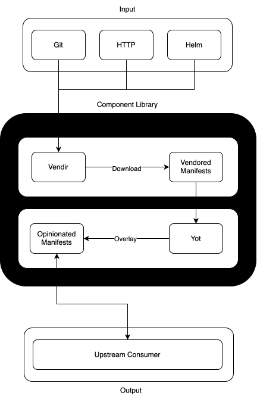

# Summary

The following is for developers and outlines how to:

1. [Add New Project](#add-new-project)
2. [Upgrade Existing Project](#version-upgrade)


## Diagram




## Add New Project

To add a new project, first add the necessary sub-directories and files in the
`.source` directory.

```bash
export CATEGORY=<category of project, e.g. database>
export PROJECT=<some project, e.g. cloudnative-pg>
make project
```

This creates a scaffold structure at `.source/$CATEGORY/$PROJECT`.


### Download From Upstream

Write your vendir file at `.source/$CATEGORY/$PROJECT/config/vendor.yaml`

See https://carvel.dev/vendir/docs/v0.46.x/vendir-spec/.  This
file points at the upstream and "vendors" the manifests locally.

> **NOTE:** for Helm, ensure you write the helm values you need.  These values
> are applied after download.  The Helm values file should exist at
> `.source/$CATEGORY/$PROJECT/config/values-helm.yaml`

```bash
make download
```

### Overlay Into Opinionated State

Write your YOT overlay files at `.source/$CATEGORY/$PROJECT/config/overlays/*`

The YOT overlay instructions provide instructions to produce the opinionated manifests (the output).  
Refer to other examples in this project and the [yaml-overlay-tool
docs](https://docs.yaml-overlay-tool.io/).  Overlay the upstream manifests with
yot to produce the final static manifests.

```bash
make overlay
```


## Version Upgrade

Following is an example of upgrading the cloudnative-pg manifests.

First, update the version number in the URL for the cloudnative-pg manifest in
`.source/database/cloudnative-pg/config/vendor.yaml`.

> **NOTE:** the cloudnative-pg URL contains the version in both the release branch
> and the file name (e.g. `release-1.30/releases/cnpg-1.30.1.yaml`).  Because the
> downloaded file name changes, also update the `path` in each overlay at
> `.source/database/cloudnative-pg/config/overlays/*`.

Then you can sync the latest manifests as follows.

```bash
export CATEGORY=database
export PROJECT=cloudnative-pg
make download
```

Next, apply the overlays.

```bash
make overlay
```

Now the manifests in the `database/cloudnative-pg` directory will be updated
to the latest version specified in `.source/database/cloudnative-pg/config/vendor.yaml`.

> **NOTE:** be sure to review the output.  The upstream could have significantly changed
so each upgrade should be carefully reviewed.
